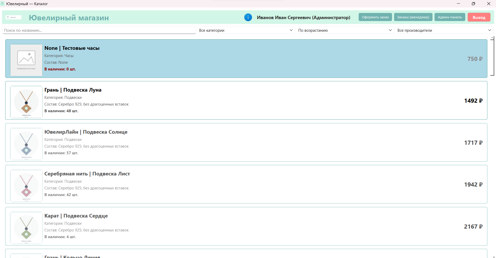

# Ювелирный магазин — Система управления каталогом и заказами

## 1. Название приложения
**Ювелирный магазин** - приложение для автоматизации продаж ювелирных изделий. Система позволяет просматривать каталог, оформлять заказы и управлять ими.

## 2. Используемые технологии
- **Язык:** Python 3.13+
- **GUI (интерфейс):** PySide6 6.8+
- **СУБД:** PostgreSQL 18.6
- **Драйвер БД:** psycopg2-binary 2.9.10+

## 3. Назначение и основные функции
Приложение автоматизирует работу ювелирного магазина. Основные функции:
- **Каталог товаров:** отображение изображений, цен, состава и остатков на складе.
- **Авторизация:** вход по логину с разграничением прав доступа (Гость, Клиент, Менеджер, Администратор).
- **Поиск и фильтрация:** сортировка по цене, фильтр по категориям и производителям, поиск по названию.
- **Подсветка:** выделение товаров со скидкой (зеленый цвет) и отсутствующих на складе (голубой фон).
- **Оформление заказов:** добавление товаров в корзину (в разработке).
- **Управление заказами:** панель менеджера и администратора (в разработке).

## 4. Порядок подготовки БД и запуска
1. Установите PostgreSQL 18.6 и создайте базу данных `up11_project`.
2. Выполните SQL-скрипты для создания таблиц (`users`, `products`) и заполнения их данными.
3. Установите зависимости: `pip install -r requirements.txt`.
4. Запустите приложение: `python main.py`.

## Автор
Студентка группы ЗИП-1-24 Можевитина Виктория Владимировна.
